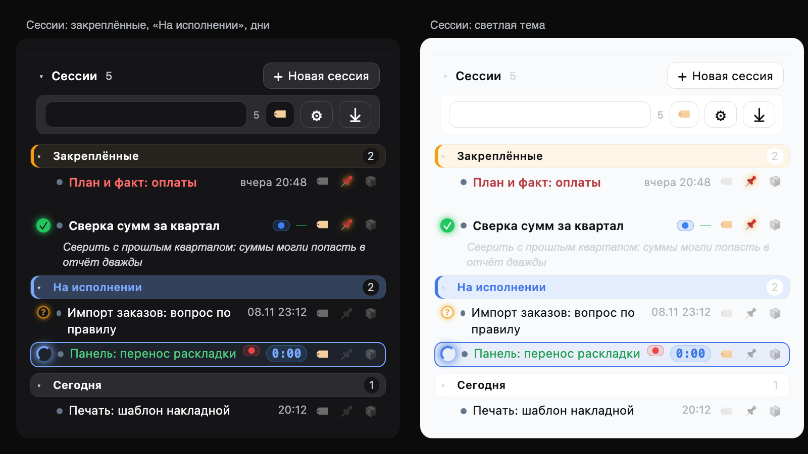
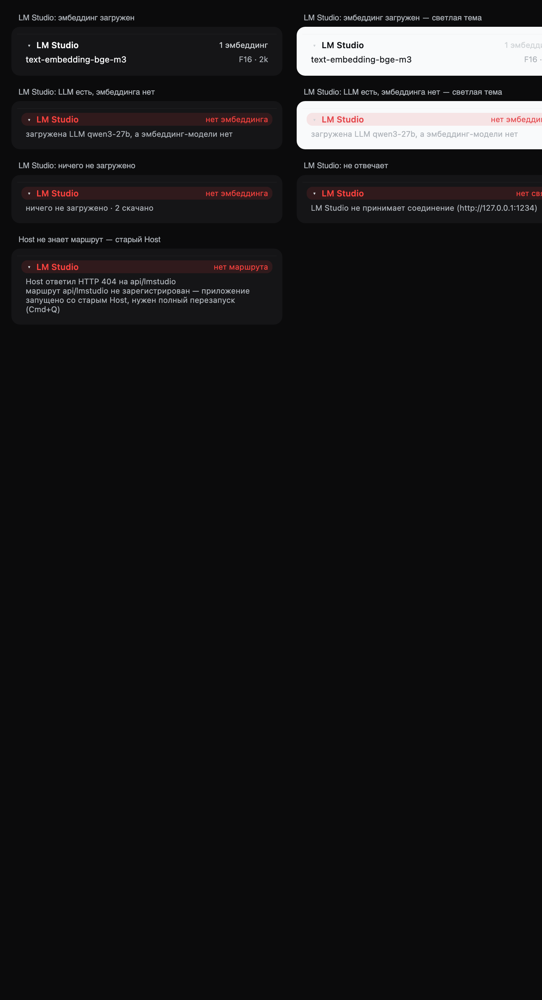

# Пульт — правая колонка dsh: сессии, MCP-серверы и локальные модели

Одна колонка правой боковой панели dsh, в которой видно всё, ради чего её
открывают: какие контексты cfsmcp2 готовы и что сейчас индексируется, загружены
ли эмбеддинги в локальный LM Studio, живы ли MCP-серверы и контейнеры, и что
происходит в сессиях Харнесса.

Колонка — это **четыре раздела и одна страница**: каталог контекстов сверху,
модели LM Studio под ним, список MCP-серверов в середине и список сессий внизу.
Всё это один bundle: одна стилистика, одно запоминание сложенного, никакой
сборки — `client.js` уже собранный браузерный бандл.



## Что нового

**1.20.1** — колонка называется **«Пульт»**: так подписаны шапка и вкладка, рядом с
названием стоит знак колонки, а группа строк серверов называется `Серверы`, не
`MCP servers`.

**1.19.0** — **одна кнопка ⚙ в шапке** раскрывает пять секций с переключателями:
каталог cfsmcp2, LM Studio, серверы и контейнеры, Oh!MyMind, сессии. Выключенная
секция не рисуется и не делает своих запросов.

**1.18.0** — галка **«применять cfsmcp2»** в настройках тегов: снятая значит, что
список сессий вовсе не обращается к cfsmcp2 — ни точек, ни тегов, ни запросов
каталога; выбранные теги cfsmcp2 снимаются с фильтра.

**1.17.1** — «метки» переименованы в **теги** во всём интерфейсе и в выгрузке.

**1.17.0** — сегодняшняя работа целиком:

- **фильтр списка**: имя + теги cfsmcp2 + свои теги, все условия вместе, «N из M», `×`;
- **группы тегов**: группа = название + уникальный символ (`● ★ ■ ▲ ◆ ⬢ ✚ ◯ ♥ ⚑`), старые теги уезжают в «Общие», группы подписаны во всех списках, cfsmcp2 — первая группа;
- **теги в выгрузке**: отдельный столбец на каждую группу, и файл считается по фильтру;
- **архив**: кнопка 📦 в строке, полоса «Архив» внизу, внутри — по месяцам, всё свёрнуто и у свёрнутого месяца теги не читаются;
- **часы хода**: длительность плашкой, замирает под зелёной галочкой;
- **рекомендация** вместо пустого комментария у закреплённой сессии (3–6 слов);
- **цвет по уровню доступа**: зелёный/обычный/красный, любой другой вариант — янтарный;
- три значка строки увеличиваются вдвое под курсором.

## Разделы

| Раздел | Что показывает |
|---|---|
| **Контексты cfsmcp2** | каждый контекст поиска с версией, синонимом, тегами и прогрессом индексации, фильтр по имени/синониму/теге, чипы меток, очередь индексации и действие «Загрузить» на контекст |
| **LM Studio** | **эмбеддинг**-модели, загруженные в локальный LM Studio прямо сейчас (чат-модели не показываются); голова красная, пока эмбеддинга нет, пока LM Studio не отвечает или пока Host не знает маршрут |
| **Серверы и контейнеры** | строка на каждый отслеживаемый контейнер или нативный MCP-сервер: точки состояния, связь с сессией, возраст данных, старт/стоп/рестарт и пузырь с подробностями |
| **Сессии** | все непустые сессии Харнесса, свежие сверху: полоса **«Закреплённые»**, затем **«На исполнении»**, затем дни (**Сегодня / Вчера / Позавчера / Далее**) и «+ Новая сессия» |

Каждая шапка складывает свой блок, каждая полоса группы (группа серверов, день) —
свои строки.

## Требования

- **dsh** с профилем, где смонтированы `connection` и `ui-sidebar-right` — они
  входят в composition `dsh-web-app`, то есть в обычную desktop/web-поставку.
  Плагин ничего не патчит в установленном dsh.
- **Node.js** `^22.19 || >=24` — то же ограничение, что у dsh.
- **Зависимостей нет**: `client.js` — готовый браузерный бандл, хост-половина
  использует только `node:` и `fetch`. Установка — это `pnpm add` из GitHub и
  включение строки, сборки нет.
- **Необязательно, по разделам:**
  - **Docker** — для строк-контейнеров (без него строки с `container` не получат
    состояние, а действия вернут ошибку);
  - **LM Studio** на `127.0.0.1:1234` — для раздела моделей;
  - **cfsmcp2** на `127.0.0.1:8559` — для каталога контекстов;
  - **`zstd`** (`brew install zstd`) — только для экспорта сессий: журнал сессии
    — цепочка zstd-кадров, а встроенный `zlib` читает лишь первый.

Раздел, которому не хватает своего сервера, честно говорит об этом и не мешает
остальным.



## Установка

Плагин ставится **прямо из GitHub** — ни клонировать, ни собирать ничего не нужно.

### Через интерфейс (проще всего)

1. Боковая панель → **Plugins** → **Add plugin**.
2. Вставить адрес репозитория:

   ```
   github:askred-dot-ru/dsh-pult
   ```

   (понимается и `https://github.com/askred-dot-ru/dsh-pult.git`, и путь к
   локальному клону, если он у вас есть).
3. **Install** → дождаться pnpm → **Enable now** — эта кнопка сама включает строку
   в профиле, вручную править `package.json` не нужно.
4. Перезапустить dsh: строки Loader читаются при старте процесса.

### Через CLI

```sh
dsh plugin --profile desktop add github:askred-dot-ru/dsh-pult
# затем включить bundle: в ~/.dsh/profiles/desktop/package.json добавить
# "dsh-pult" в dsh.profile.bundles — `plugin add` только ставит зависимость
pnpm install            # в каталоге профиля, если правили package.json руками
```

Профильный `package.json` после установки:

```json
{
  "dependencies": {
    "dsh-pult": "link:/путь/к/клону/dsh-pult"
  },
  "dsh": {
    "profile": {
      "bundles": [
        "@deepseek-ai/dsh-base",
        "@deepseek-ai/dsh-web-app",
        "dsh-pult"
      ]
    }
  }
}
```

### Проверка и откат

- В карточке плагина — строка `dsh-pult`; в сайдбаре появляется вкладка **«Пульт»**
  с четырьмя разделами.
- Компонент **Обновить** в карточке: плагины из Git не обновляются сами —
  обновление это переустановка более новой версии.
- Откат: выключить строку в карточке (или убрать `"dsh-pult"` из
  `dsh.profile.bundles` и `dependencies`), затем `pnpm install` в каталоге профиля
  и перезапуск dsh.
- **Если у вас уже стоит `@local/mcp-panel`** (прежнее имя этой же панели) —
  выключите его: страница регистрируется под одним и тем же `TAB_ID`, и две копии
  будут спорить за одно место в сайдбаре.

## Настройка строки

Все ключи строки — необязательные; значения ниже — то, что корабль везёт по
умолчанию (`cordis.patch.yml` пакета). Править можно в `cordis.patch.yml` профиля
или в карточке плагина.

```yaml
- insert:
    - id: pult
      name: 'dsh-pult'
      config:
        targets: []
        pollMs: 5000
        probe: true
        confirmActions: false
        url: http://127.0.0.1:8559/mcp/
        contextsTtlMs: 300000
        contextsTimeoutMs: 8000
        indexTtlMs: 3000
        importTimeoutMs: 120000
        lmStudioUrl: http://127.0.0.1:1234
        lmStudioTimeoutMs: 4000
        # sessionsRoot: ~/.dsh/sessions
        # exportDir: ~/Downloads
        # openExport: true
```

| Ключ | По умолчанию | Что делает |
|---|---|---|
| `targets` | `[]` | список отслеживаемых строк — контейнеров и MCP-серверов; **пусто намеренно**, чужие серверы никто не угадает (форма записи ниже) |
| `pollMs` | `5000` | как часто панель перечитывает состояние серверов |
| `probe` | `true` | диалить ли endpoint MCP-сервера, чтобы отличить «процесс жив» от «порт отвечает» |
| `confirmActions` | `false` | спрашивать ли подтверждение на стоп и рестарт |
| `url` | `http://127.0.0.1:8559/mcp/` | MCP-адрес cfsmcp2 |
| `contextsTtlMs` | `300000` | сколько живёт прочитанный каталог контекстов |
| `contextsTimeoutMs` | `8000` | таймаут одного вызова cfsmcp2 |
| `indexTtlMs` | `3000` | как часто перечитывается состояние индексации |
| `importTimeoutMs` | `120000` | сколько ждать «Загрузить» на контексте |
| `lmStudioUrl` | `http://127.0.0.1:1234` | адрес LM Studio |
| `lmStudioTimeoutMs` | `4000` | таймаут запроса моделей |
| `sessionsRoot` | `~/.dsh/sessions` | где лежат журналы сессий |
| `exportDir` | `~/Downloads` | куда писать экспорт |
| `openExport` | `true` | открывать ли книгу Excel сразу после записи |
| `abbreviations` | — | короткие имена для синонимов контекстов в заголовках |

### Запись в `targets`

Строка — это контейнер, контейнер с MCP-сервером или нативный MCP-процесс. Только
строку с контейнером можно запускать и останавливать.

```yaml
targets:
  # MCP-сервер в контейнере: состояние, действия, связь с сессией, диальчик порта.
  - group: MCP servers
    container: cfsmcp2-cfsmcp2-1
    label: cfsmcp2
    server: cfsmcp2
    url: http://127.0.0.1:8559/mcp/

  # Нативный MCP-сервер: контейнера нет, есть только связь с сессией и диальчик,
  # плюс возраст данных по каталогам из dataPaths.
  - group: MCP servers
    container: null
    label: openviking
    server: openviking
    url: http://127.0.0.1:1933/mcp
    dataPaths: ['~/.openviking/data/viking']

  # Просто контейнер, без MCP: строка состояния и кнопки.
  - group: containers
    container: my-worker-1
    label: my-worker-1
```

| Поле | Обязательно | Смысл |
|---|---|---|
| `container` | нет | имя контейнера Docker; `null` — нативный сервер (запускать нечего) |
| `server` | нет | `serverName` из `dsh-mcp-client`; по нему строка понимает, что инструменты сервера зарегистрированы в текущей сессии |
| `label` | нет | что написано в строке; по умолчанию `server`, иначе имя контейнера |
| `group` | нет | заголовок группы; по умолчанию `MCP servers` для серверов и `containers` для остальных |
| `url` | нет | endpoint для диальчика; пусто — не диа́лить |
| `dataPaths` | нет | каталоги данных нативного сервера: строка покажет самый свежий mtime, `~` раскрывается |

Строка, у которой нет ни `container`, ни `server`, пропускается.

## Разделы подробнее

### Контексты cfsmcp2

Каталог читается с MCP-сервера cfsmcp2 (`list_context_groups` и спутники), а
состояние индексации — с его REST: `/api/system/job-queue`, `/api/entities`,
`/api/tags`. cfsmcp2 — сервер семантики по коду и метаданным 1С, поэтому синонимы
контекстов — названия продуктов 1С, а `abbreviations` сокращает их в заголовках
(УПП, БП, ЗУП и прочие) по таблице из `index.js`. Сокращение меняет только
**показанное** имя: `name` контекста — аргумент каждого вызова поиска, и он никогда
не переписывается. Поэтому у контекста видны:

- имя, версия и синоним (синоним можно сократить через `abbreviations`);
- теги контекста — чипами, с цветом из REST-каталога тегов;
- прогресс индексации: сколько объектов и методов уже разобрано, что в очереди;
- очередь: работающий контекст, ждущие, приостановленные — они идут первыми;
- фильтр по имени, синониму и теге, плюс чипы меток над списком;
- **«Загрузить»** — перечитать контекст из его источника
  (`POST api/cfsmcp2-contexts/action`). Пока сервер работает, панель показывает,
  что ждёт, и не даёт нажать второй раз.

### LM Studio

Локальный LM Studio отвечает на `127.0.0.1:1234`; браузер не может спросить его с
другого origin, поэтому `api/v0/models` забирает Host и отдаёт панели короткую
форму (`id`, `type`, `state`, `publisher`, `quantization`, `maxContext`,
`loadedContext`). Раздел опрашивает его раз в 10 с.

Раздел отвечает на один вопрос: **эмбеддинги, которые нужны MCP-серверам, в
памяти?** Поэтому показаны только модели типа `embeddings` и только загруженные;
чат-модели не показываются вовсе, а не «вторым сортом». Строка — это имя, а справа
квантование и длина контекста.

| Состояние | Голова | Справа |
|---|---|---|
| эмбеддинг загружен | обычная | «1 эмбеддинг» / «2 эмбеддинга» / «5 эмбеддингов» |
| LLM загружена, эмбеддинга нет | красная плашка | «нет эмбеддинга», ниже — какая LLM занимает память |
| ничего не загружено | красная плашка | «нет эмбеддинга», ниже — сколько моделей скачано |
| LM Studio не отвечает | красная плашка | «нет связи», ниже — причина |
| Host не знает маршрут | красная плашка | «нет маршрута», ниже — HTTP и подсказка про перезапуск |

Загруженная чат-модель поиску не помогает: LM Studio поднят и отвечает, а
`semantic_search` нечем считать эмбеддинг. Именно этот случай красная полоса и
называет.

Строка про маршрут — не про LM Studio: браузерная половина может быть новее
запущенного Host. Переключатель плагина перезагружает бандл браузера и снова
вызывает `apply` из **уже импортированного** модуля, поэтому маршрут, добавленный
в `index.js`, появляется только после перезапуска приложения. Раздел так и
говорит, вместо того чтобы валить вину на LM Studio.

### MCP-серверы

Страница показывает по строке на каждую цель из `targets`:

- **точки состояния**: контейнер запущен / здоров / остановлен, плюс отдельная
  точка «порт отвечает»;
- **связь с сессией**: зарегистрированы ли в текущей сессии инструменты
  `mcp__<server>__*`. MCP-клиент регистрирует их только после успешного connect и
  discovery и снимает, когда исчерпан бюджет переподключений, — поэтому их наличие
  и есть взгляд сессии на «подключён»;
- **возраст данных**: самый свежий mtime под `dataPaths` (для нативных серверов);
- **старт / стоп / рестарт** — только для строк с контейнером; кнопка приходит в
  состояние ожидания, а после ответа панель перечитывает снимок;
- **пузырь** с подробностями: образ, порты, состояние, endpoint, ошибка Docker.

`confirmActions: true` заставляет стоп и рестарт спрашивать подтверждение вторым
нажатием; запуск действует сразу.

### Сессии

Каждая непустая сессия Харнесса — строка, свежие сверху. Порядок не
хронологический там, где это важно: строка, которая **ждёт читателя**, уходит из
своего дня в полосу **«На исполнении»** над «Сегодня». Ждёт — значит идёт ход,
задан вопрос или ход закончился и результат ещё никто не открыл. Сессия стоит
ровно в одном месте, поэтому полоса никогда не повторяет строку из дня.

Внутри полосы порядок по тому, что строка просит у читателя, а потом по свежести:
вопрос первый (ничего не сдвинется, пока не ответят), затем живая сессия, затем
непросмотренный результат.

Сессия, открытая в основном виде, не попадает в полосу за непросмотренный
результат: читатель смотрит на неё, и закончившийся ход — не новость. Платформа
может держать флаг `completionUnread` до ухода из сессии, и строка иначе осталась
бы с зелёной галочкой в «На исполнении» уже после хода — список, который выглядит
застрявшим. Поэтому для этой одной строки флаг игнорируется: она возвращается в
свой день и галочку не рисует. Вопрос и идущий ход считаются и для неё.

| Статус | Значок | Что значит |
|---|---|---|
| работает | поворачивающееся полукольцо в деловом цвете, с ореолом, на подсвеченной строке | идёт ход |
| ждёт ответа | контурный «?» в цвете предупреждения, «дышит» | модель спросила, читатель должен ответить |
| готово, не просмотрено | залитая галочка в цвете успеха, со свечением | ход закончился, результат никто не открыл |
| без активности | значка нет; строку ведёт точка цвета проекта | тишина |

**Режим доступа в заголовке.** Когда в поставке есть сервис разрешений, заголовок
каждой строки несёт пресет сессии: `read-only` — безопасный, зеленеет,
`danger-full-access` — опасный, краснеет, обычный `workspace-write` остаётся
спокойным. Подкраска — `color-mix` цвета состояния с цветом подписи, поэтому
один токен читается в обеих темах; подсказка строки называет режим словами
(«доступ: полный доступ»). Строка без `projections.permissions` рисуется обычно.

Сессия, открытая в основном виде, помечена ещё и контуром в деловом цвете, чтобы
было видно, где вы, не читая заголовков. Контур — внутренняя тень: он повторяет
радиус строки, не меняет её размер и не портит подложку живой строки. Подсказка
добавляет «открыта сейчас».

**Теги из cfsmcp2.** Строка подписывается от своего `cwd` в два прохода:

1. **контекст**, имя которого — целый сегмент пути (побеждает самый длинный, так
   `shop_a` бьёт `shop`), а его теги становятся чипами;
2. иначе — **тег**, имя которой целый сегмент пути, самая глубокая: для
   `/Users/alex/work/shop/tmp` это `work`, если `work` заведён тегом, а при
   нескольких подходящих побеждает та, что глубже в пути. Контекст без своих
   меток откатывается к той же теге.

Точка берёт цвет первого чипа. Весь каталог меток, с цветами, читается из REST
`/api/tags` и накладывается поверх MCP `list_context_groups`, который называет
только теги, привязанные к готовому контексту, — поэтому тег без своего
контекста всё равно сохраняет цвет. Подсказка строки называет совпадение словами:
«контекст: shop» или «тег по папке: work».

**Свои теги.** Это теги читателя, отдельно от меток контекстов cfsmcp2: ничего
не импортируется, каталог строится руками. Тег — это имя и цвет; кнопка **🏷** в
шапке рядом с «+ Новая сессия» открывает менеджер, где тег создают,
переименовывают, перекрашивают и удаляют. Удаление снимает тег со всех сессий.

Строка помечается из самой строки: у каждой есть кнопка **🏷** перед иголкой
(приглушена, пока меток нет), она открывает выбор под строкой, где любая известная
тег включается и выключается сразу. Чипы стоят **справа от заголовка,
непосредственно перед временем**: сначала теги читателя — в своём цвете, потом
теги от `cwd`. Заголовок забирает оставшееся место и обрезается многоточием. Когда
колонка уже, чем 420 px, подписи чипов сбрасываются: тег показывает только точку, а
теги cfsmcp2 от `cwd` скрываются — ведущая точка всё так же несёт цвет
портфеля, полное имя в подсказке.

Оба списка живут в хранилище панели (`tags`, `sessionTags`), поэтому переживают
перезагрузку и общие для сайдбара всех сессий. У cfsmcp2 свои теги контекстов; две
системы не пересекаются, и тег сессии никогда не меняет контекст поиска.

**Пустые сессии не показываются.** Сессия пуста до первого сообщения; такие строки —
заглушки (обычно брошенные «+ Новая сессия»), и плагин их пропускает
(`blank === true` в строке списка). С первым сообщением строка появляется.

### «Закреплённые», иголка и комментарий

У каждой строки справа, рядом со временем, есть иголка. Клик закрепляет сессию:
она уходит из своей полосы — «На исполнении», дня — в **«Закреплённые»**, самую
громкую полосу списка, прямо над «На исполнении». Второй клик открепляет, и строка
возвращается в полосу, которой соответствует по своей дате и статусу.

Иголка главнее вычисленных полос, с одним исключением: **сессия, в которой сейчас
идут действия ИИ, уходит в «На исполнении»** на время хода, чтобы работа была там,
где её ищут. Сама иголка не снимается — ход закончится, и строка вернётся в
«Закреплённые». Вопрос и непросмотренный результат остаются в закреплённой полосе,
где значок статуса всё равно виден.

Полоса закреплённых покрашена тёплым акцентом (`state-warn-tertiary` плюс 3 px
`state-warn-primary`, подпись в `state-warn-label`), а заголовки строк в ней
набраны тяжелее — читатель сам положил эти строки сюда, значит они громче живой
полосы.

«Закреплённые» охватывают дни, поэтому их строки называют день словами — кроме
сегодняшнего, где только время: `14:05`, «вчера 09:12», «позавчера 18:40» и
`ДД.ММ ЧЧ:ММ` для всего старше. В дневных полосах день не повторяется: шапка его
уже сказала.

**Комментарий.** Закреплённая строка может нести одну короткую затег (до 300
символов). Она рисуется двумя курсивными строками под строкой, с отступом до
заголовка; длинный текст обрезается, полный — в подсказке. Клик по строке открывает
правку на месте: поле на две строки, `Enter` сохраняет, `Esc` отменяет, очистка
поля удаляет комментарий. Без комментария закреплённая строка показывает бледное
«+ комментарий» при наведении, чтобы не занимать строку впустую.

Комментарий принадлежит иголке: как только строка вернулась в «На исполнении» или
свой день, строка пропадает и текст доступен только в подсказке. Повторное
закрепление возвращает её на место, потому что текст хранится по id сессии в
`notes`.

### Фильтр списка

В строке поиска три независимых условия, и они работают **вместе**:

| Условие | Что делает |
|---|---|
| поле поиска | полнотекстовый отбор по наименованию сессии, «поиск по наименованию сессий…» |
| чипы тегов | отбор по тегам: cfsmcp2 и свои |
| счётчик `N из M` | сколько строк осталось от всех |

Внутри одного условия действует **ИЛИ** (несколько тегов — любая из них), между
условиями — **И**: «отчёт + тег p0 + свой тег срочно» оставит только то, что
подходит под все три. Рядом — `×`, снимающий все условия сразу. Пустой результат
пишет «ничего не найдено по фильтру». Состояние фильтра живёт в хранилище панели,
поэтому переход в другую сессию его не сбрасывает.

Теги по умолчанию **скрыты** — их раскрывает кнопка 🏷; при активном, но свёрнутом
фильтре кнопка подсвечена и показывает число выбранных условий.

### Галка «применять cfsmcp2»

Первая строка в настройках тегов (⚙ в строке поиска). Включена по умолчанию;
выключенная значит, что список сессий **вовсе не читает cfsmcp2**:

| Что | Включено | Выключено |
|---|---|---|
| запрос каталога `api/cfsmcp2-contexts` | идёт | **не идёт ни одного** |
| точка проекта в строке | цвет контекста | **точки нет** |
| теги cfsmcp2 в строке | чипы с цветом | **нет** |
| группа `cfsmcp2` в фильтре | первая | **нет** |
| теги cfsmcp2, выбранные в фильтре | сохраняются | **снимаются** при выключении |
| свои теги, группы, архив, часы хода | работают | работают так же |

Настройка живёт в хранилище панели и переживает перезагрузку. Выгрузка за период при
выключенной галке пишет пустые столбцы cfsmcp2 — читать их не из чего.

### Группы тегов

Свои теги живут **группами**. У группы есть название и **символ**, и символ — её
опознавательный знак: на строке сессии тег рисуется символом своей группы, а не
точкой, поэтому видно, из какой он группы.

| Что | Как |
|---|---|
| символ группы | `●` кружок, `★` звёздочка, `■` квадрат, `▲` треугольник, `◆` ромб, `⬢` шестиугольник, `✚` крест, `◯` кольцо, `♥` сердце, `⚑` флажок |
| уникальность | символ принадлежит одной группе; занятый в списке недоступен, а попытка выставить его отказывается |
| число групп | задаёт читатель; когда все десять символов заняты, форма новой группы гаснет |
| удаление | удаляет теги группы и их назначения на сессиях; последнюю группу удалить нельзя |

Теги, созданные до появления групп, читаются как группа **«Общие»** с кружком —
это делает миграция при чтении хранилища, писать ничего не нужно.

**Везде, где теги предлагаются на выбор, они разделены по группам, и группа
подписана** — в менеджере (⚙), в пикере под строкой, в диалоге «Новая сессия»
(там группы стоят колонками) и в чипах фильтра, где каждая группа начинается с
новой строки. Отдельной строки «мои» нет: **cfsmcp2 — такая же группа тегов и
всегда первая**, за ней свои группы в порядке справочника.

### Архив

Последняя полоса списка — **«Архив»**, кнопка 📦 в строке отправляет сессию туда,
повторный клик возвращает. Вне архива значок серый и приглушённый, в архиве —
включён и подсвечен.

Внутри архив разложен **по месяцам** («Ноябрь 2026», «Октябрь 2026», …), свежий
месяц выше, и все месяцы **всегда свёрнуты**: открытое состояние не запоминается.
Свёрнутый месяц не показывает ни строк, ни тегов — сессии не строятся, пока месяц
не развёрнут, поэтому год архива стоит несколько строк.

### Часы хода, рекомендация и цвет доступа

| Что | Как |
|---|---|
| **часы хода** | пока ход идёт, справа вместо времени стоит длительность в плашке (`3:41`, после часа `1:02:05`); под зелёной галочкой число замирает и уходит вместе с ней |
| **рекомендация** | у закреплённой сессии без своего комментария после хода появляется подсказка на 3–6 слов («сверить итог и снять иголку»), тише и мельче комментария, с ведущей `↳`; клик переносит её в поле комментария |
| **цвет заголовка** | `read-only` — зелёный, `workspace-write` — обычный, `danger-full-access` — красный, **любой другой вариант** (производный `custom`, свой пресет сборки) — янтарный |

### Экспорт сессий за период

Кнопка **⤓** в строке поиска открывает маленькую панель: две даты (по умолчанию
предыдущий месяц) и два действия — **JSON** и **Excel**. Файл считается **по
текущему фильтру**: в него попадают ровно те сессии, что видны в списке, а панель
пишет «сессий по фильтру: N из M».

В книге после плоского столбца «Теги сессии» идёт **по столбцу на каждую группу
тегов** (`● Общие`, `★ Проекты`, …) со значениями, отмеченными у сессии в этой
группе. В JSON то же структурой: `tag_groups` в корне — справочник групп, и
`tag_groups` у каждой сессии — `{ group, shape, tags }`. Оба файла Host пишет в
`~/Downloads` как `sessions-<from>_<to>.<ext>`; панель показывает получившийся путь.
Книга Excel **открывается сразу после записи** (macOS `open`), чтобы цифры были на
экране без похода в Finder; `openExport: false` это выключает. JSON только
пишется, никогда не открывается.

Данные берутся из хранилища сессий на диске
(`~/.dsh/sessions/<bucket>/<session>/session*.jsonl.zstd`). Работа сессии — её
**ходы**: `turn/start` … `turn/end` несут оба конца, а активное время — сумма ходов,
обрезанная периодом, то есть время, которое агент действительно работал, а не
время, пока сессия была открыта. Даты — первый и последний ход внутри периода,
поэтому маркер, записанный днями позже, их не растягивает. Экспортируются только
сессии, у которых в периоде есть хотя бы один ход.

Журнал — цепочка zstd-кадров, на которой `zlib` останавливается после первого
кадра; поэтому Host зовёт CLI `zstd` и говорит об этом в панели, если бинарника нет.

Форма JSON (каждая тег cfsmcp2 — отдельным полем, теги самой сессии — списком):

```json
{
  "period": { "from": "2026-10-01", "to": "2026-10-31" },
  "generatedAt": "2026-11-06T11:18:39.304Z",
  "total": { "activeMs": 105600000, "active": "29 ч 20 мин" },
  "sessions": [
    {
      "session": "Квартальный отчёт",
      "cfsmcp2_tag_1": "work",
      "cfsmcp2_tag_2": "",
      "cfsmcp2_tag_3": "",
      "session_tags": ["Срочно"],
      "started_at": "2026-10-06 15:06",
      "ended_at": "2026-10-26 16:37",
      "active": "2 ч 13 мин",
      "active_hours": 2.21
    }
  ]
}
```

Книга Excel содержит те же колонки (Наименование сессии · три теги cfsmcp2 · теги
сессии · начало · окончание · активное время, ч) плюс жирную строку **Итого** с
суммой часов.

### Название и знак

Продукт называется **«Пульт»** — так подписаны шапка страницы и вкладка в сайдбаре,
рядом стоит знак колонки: тот же глиф, что в `icon.svg` (рамка и три штриха),
вставленный инлайном, поэтому он берёт цвет акцента из темы. Идентификаторы вкладки
(`kind`, `id`) и имена мест не менялись — сайдбар помнит открытую вкладку по ним.

### Настройки панели: пять секций

В шапке рядом с `⟳` стоит **⚙ — одна кнопка настроек на всю колонку**. Она
раскрывает карточку с пятью областями и переключателем у каждой:

| Секция | Что прячется при выключении |
|---|---|
| **Каталог cfsmcp2** | вся секция каталога; список сессий заодно перестаёт читать cfsmcp2 — ни запросов, ни точек, ни тегов |
| **LM Studio** | секция моделей и её опрос |
| **Серверы и контейнеры** | строки серверов и вся их панель |
| **Oh!MyMind** | строки группы `ohimymind` — четыре контейнера (`api`, `worker`, `embedder`, `db`); когда появится отдельная секция с индексом знаний, эта галка будет владеть и ею |
| **Сессии** | список сессий внизу страницы целиком |

Выключенная секция **не рисуется вовсе** — не прячется стилями, а просто отсутствует,
поэтому и опроса своего не делает. Кнопка ⚙ остаётся на месте при любом наборе:
иначе выключенное было бы не вернуть. Состояние лежит в хранилище панели (`sections`)
и переживает перезагрузку.

## Что сложено — запоминается

Состояние складывания — маленькое хранилище в `localStorage` под ключом
`dsh.pult.v1`:

```json
{
  "catalogue": false,
  "sessions": false,
  "models": false,
  "groups": ["containers"],
  "buckets": ["yesterday"],
  "pins": ["3f1c9a02"],
  "notes": { "3f1c9a02": "сверить суммы с прошлым кварталом" },
  "tags": [{ "id": "tag-1", "name": "Срочно", "color": "#ef4444" }],
  "sessionTags": { "3f1c9a02": ["tag-1"] }
}
```

Сложили всё, кроме списка сессий, в одной сессии — ровно так это выглядит в
следующей, а разложили обратно там же. Состояние принадлежит панели, не сессии: это
приспособление для чтения, и человек не должен складывать одни и те же четыре
раздела при каждом переключении.

## Как это устроено

| Файл | Роль |
|---|---|
| `client.js` | страница: каталог контекстов, модели, список серверов, список сессий и хранилище сложенного |
| `index.js` | четыре хост-половины: маршруты и конфигурация |
| `cordis.patch.yml` | одна строка Host с объединённой конфигурацией |
| `scripts/preview.mjs` | статический рендер панели в HTML для скриншотов (`npm run preview` → `docs/*.html`) |
| `icon.svg` | иконка пакета |

Маршруты Host, по одной семье на половину, все относительные к документу:

| Маршрут | Назначение |
|---|---|
| `api/mcp-docker-status` | снимок состояния серверов и контейнеров |
| `api/mcp-docker-status/action` | старт / стоп / рестарт контейнера |
| `api/cfsmcp2-contexts` | каталог, состояния сущностей и очередь индексации |
| `api/cfsmcp2-contexts/action` | перечитать контекст из источника |
| `api/lmstudio` | модели LM Studio с их загруженностью |
| `api/sessions-activity` | ходы по сессиям внутри периода, из хранилища сессий |
| `api/sessions-export` | записать JSON/XLSX в `~/Downloads` |

## Устойчивость и диагностика

Вход бандла не бросает исключений: каждая регистрация (тип вкладки, страница,
места, установка стилей, автооткрытие) обёрнута в свой `try/catch`, отказ пишется в
консоль как `[dsh-pult] <шаг>` и не роняет остальные. Хост-половина устроена так же
(`start()` внутри guarded `apply`). Причина — отказ одной регистрации в dsh
репортится как «бандл не активировался» и уносит всю загрузку приложения, а панель
сайдбара этого не стоит.

Клиентская половина после активации отправляет `POST api/dsh-pult/diag` с отчётом
(какие регистрации прошли, какая отказала и с какой ошибкой), а хост-половина пишет
его в `$TMPDIR/dsh-pult-activation.log` и в лог хоста. Если файл пуст — бандл не
доехал до браузера; если в нём есть `failed` — виден точный шаг. Каждый старт Host
пишет туда же строку `host start routes=…`: если в файле нет свежей строки с нужным
маршрутом, значит работает старый Host и приложение надо перезапустить, а не
переключать плагин. Временный инструмент удаляется вместе с `DIAG_PATH` в
`index.js`.

### Сайдбар помнит вкладку на каждую сессию

Вкладка запоминается парой `kind`/`id`. Страница сохраняет пару прежней вкладки
серверов — `kind: 'mcp-docker-status'`, `id: '@local/cfsmcp2-contexts'` — поэтому
сессия, запомнившая вкладку до объединения, открывает её, а не заглушку «Nothing
here can view this kind of content yet». В справочнике (`guide`) страница одна.

## Разработка

Сборки нет: `client.js` — готовый браузерный бандл, `index.js` — обычный ESM.
Проверка синтаксиса и рендер превью:

```sh
npm run check          # node --check index.js && node --check client.js
npm run preview        # docs/preview.html, docs/preview-sessions.html, docs/preview-models.html
```

`scripts/preview.mjs` подменяет React заглушкой и вызывает настоящие компоненты
панели с вымышленными данными, поэтому картинки в README — это реальный рендер
кода, а не макет. Скриншоты снимаются с получившихся HTML-страниц.

## Лицензия

MIT — см. [LICENSE](LICENSE).
